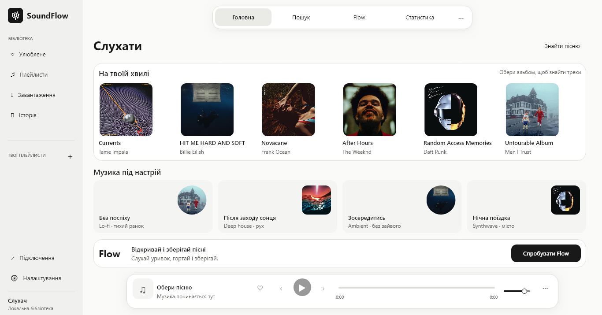

# SoundFlow

Нативний музичний застосунок для **Linux** та **Windows**: **Rust + Slint**, аудіо через Rodio/Symphonia (PipeWire, PulseAudio або ALSA на Linux). Інтерфейс не використовує HTML, браузер, Electron, Tauri або WebView2. Python вилучений із застосунку та збірки.

Компактна світла й темна теми без синього акценту, плаваюча навігація та плеєр, адаптивні обкладинки, клавіатурне керування й нативна доступність.

## Завантажити для Linux x64

[Графічний інсталятор (.run)](https://github.com/feodaI/SoundFlow/releases/download/v3.4.0/SoundFlow-3.4.0-Linux-Installer.run) · [Portable TAR.GZ](https://github.com/feodaI/SoundFlow/releases/download/v3.4.0/SoundFlow-3.4.0-linux-x64.tar.gz) · [Нотатки релізу](https://github.com/feodaI/SoundFlow/releases/tag/v3.4.0)

- **Графічний інсталятор (`.run`)**: універсальний саморозпаковуваний інсталятор із майстром GUI (Zenity / CLI), вибором каталогу встановлення, інтеграцією в системне меню, створенням ярлика на Робочому столі та деінсталятором `uninstall.sh`.
- **Portable TAR.GZ**: розпакуй у будь-яке місце й запусти `./soundflow.sh` або `./soundflow`.

## Завантажити для Windows x64

[Інсталятор SoundFlow](https://github.com/feodaI/SoundFlow/releases/download/v3.4.0/SoundFlow-3.4.0-Setup.exe) · [Portable ZIP (v3.4.1)](https://github.com/feodaI/SoundFlow/releases/download/v3.4.1/SoundFlow-3.4.1-windows-x64.zip) · [Нотатки релізу](https://github.com/feodaI/SoundFlow/releases/tag/v3.4.1)

Інсталятор встановлює застосунок для поточного користувача та створює ярлики. Для portable-версії розпакуй увесь архів і запусти `SoundFlow.exe`. Бібліотека залишається окремо від файлів програми.



## Можливості

- Багатомовний інтерфейс (Українська 🇺🇦 та English 🇺🇸) із миттєвим перемиканням без перезапуску застосунку.
- Пошук, відтворення та завантаження аудіо з YouTube і SoundCloud.
- Метадані Spotify та явний вибір версії треку з YouTube/SoundCloud. Spotify не надає оригінальні аудіофайли для завантаження.
- Локальна музика, улюблені треки, плейлисти, історія, імпорт і експорт бібліотеки.
- Flow: уривки треків, пропуск, лайк і збереження в плейлист. Без спеціальної розмітки уривок вибирається поблизу середини треку; це не гарантує приспів.
- Керування та відмова від підписки SoundFlow Plus (оформлення, зміна тарифу та скасування підписки на Linux і Windows).
- Облік фактично прослуханого часу в SQLite та імпорт історії сервісів. Перегляд статистики потребує підтвердженого сервером SoundFlow Plus.
- Один екземпляр вікна. Для онлайн-музики запускається максимум один дочірній JavaScript-процес; він завершується разом із застосунком.

## Запуск і збірка

### Linux

- **Готові установщики**: графічний майстер `dist/SoundFlow-3.4.0-Linux-Installer.run`.
- **Portable-версія**: розпакуй `dist/SoundFlow-3.4.0-linux-x64.tar.gz` і запусти `./soundflow.sh` або `./soundflow`.

Для розробки під Linux:

```bash
# Встановлення залежностей та збірка медіа-провайдера
(cd media-provider && npm ci)
node scripts/build-provider.mjs

# Збірка та тестування
./scripts/build-linux.sh Build
./scripts/build-linux.sh Test
(cd media-provider && npm test)

# Пакування дистрибутива та інсталяторів (.run, .rpm, .tar.gz)
./scripts/package-linux.sh
./scripts/verify-linux.sh
```

Докладніше: [Linux](docs/LINUX.md).

### Windows

Готова portable-версія: `dist/windows-x64/SoundFlow.exe`. Інсталятор: `dist/SoundFlow-3.4.0-Setup.exe`. Python, Node.js і WebView2 встановлювати не потрібно.

Для розробки потрібні Rust 1.92+, MSVC Build Tools, Windows SDK і Node.js. SDK можна підготувати без адміністратора:

```powershell
.\scripts\setup-windows-sdk.ps1
npm.cmd ci --prefix media-provider
node scripts/build-provider.mjs
.\scripts\build-windows.ps1 -Action Dev
```

Збірка й перевірка:

```powershell
.\scripts\build-windows.ps1 -Action Build
.\scripts\build-windows.ps1 -Action Test
.\scripts\package-windows.ps1
npm.cmd test --prefix media-provider
powershell.exe -NoProfile -ExecutionPolicy Bypass -File .\scripts\verify-windows.ps1 -Executable .\dist\windows-x64\SoundFlow.exe
```

Докладніше: [Windows](docs/WINDOWS.md), [архітектура](docs/ARCHITECTURE.md), [хмарний API](docs/CLOUD-API.md).

Перевірки релізу 3.4.0: 25 Rust-тестів, 6 тестів медіарушія, запуск у Linux і Windows, UI Automation без безіменних кнопок, один екземпляр вікна, власні іконки, завершення дочірнього процесу, повне декодування AAC/MP3 та встановлення зі збереженням бібліотеки. [Історія змін](CHANGELOG.md).

## Структура

```text
src/                 Rust: застосунок, бібліотека, статистика, аудіо, Linux та Windows
ui/                  Slint: екрани, компоненти й тема
media-provider/      JavaScript-адаптери музичних сервісів і тести
resources/           іконки, обкладинки, ліцензії, runtime та інсталятори
scripts/             відтворювана збірка, пакування й перевірка (Linux та Windows)
docs/                документація Linux/Windows, архітектура та контракти
```

Дані користувача зберігаються в `~/.local/share/app.soundflow.desktop` на Linux та `%APPDATA%\app.soundflow.desktop` на Windows; встановлення та видалення програми не видаляють бібліотеку чи музику. Стару JSON-бібліотеку можна імпортувати в налаштуваннях.

## Хмарні акаунти й Plus

Клієнт містить авторизацію, синхронізацію та перевірку підписки через власний HTTPS-сервіс. **Сервер акаунтів і платежів у цьому репозиторії не розгорнутий**. Ціна $1/місяць задається платіжним сервісом; клієнт не може підтвердити оплату самостійно. Локальні налаштування чи імпортований JSON не розблоковують Plus.

Аудіо та доступність каталогів залежать від джерела. Публічний профіль сервісу дозволяє імпортувати доступні треки; він не дає доступу до приватної історії прослуховувань або Spotify OAuth.

Slint використовується за Royalty-free Desktop, Mobile, and Web Applications License 2.0. Атрибуція доступна в меню «Про SoundFlow». Ліцензії Node.js, музичного адаптера й обкладинок включені до Windows-пакета.
